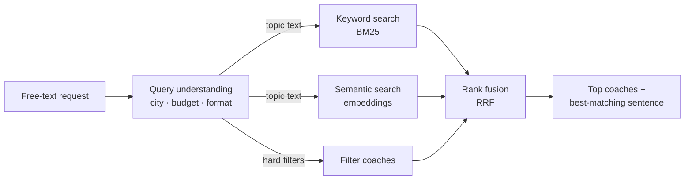

# Coach search: keyword vs. semantic vs. hybrid, measured

**A prototype for matching companies with coaches and trainers from a free-text request — and an honest evaluation of which search method works.**

A company types what it needs in its own words, for example *"Konfliktlösung für unser Vertriebsteam in Hamburg, vor Ort, max. 2.000 €"* (conflict resolution for our sales team in Hamburg, on site, max €2,000). The system has to understand the hard requirements, find the right coaches, and explain why each one fits.

🔎 **Try it:** [live demo](https://coach-search.streamlit.app/) · 📊 **Results:** below · 🧪 **Run it yourself:** `python evaluate.py`

> All 30 coach profiles are **synthetic** — invented names and bios, not real people or platform data.

## How it works



| Step | What it does | Why |
|---|---|---|
| **Query understanding** | Rules extract city, budget and format ("vor Ort" / online) and remove them from the text | Numbers and places must be exact — embeddings don't do maths |
| **Keyword search (BM25)** | Scores word overlap; rare words count more | Exact names: *DISG*, *PRINCE2*, *ChatGPT* |
| **Semantic search** | Multilingual embeddings (`paraphrase-multilingual-MiniLM-L12-v2`), cosine similarity | Synonyms, paraphrases, English queries on German profiles |
| **Chunking** (tested) | Scores each profile by its best-matching sentence, not the average of the whole profile | Meant to fix *dilution*. It made ranking worse on this data (see results), so the demo uses chunks only for the explanation |
| **Hybrid (RRF)** | Merges the keyword and semantic rankings: each coach gets 1 / (60 + rank) from each list | Results both methods agree on rise to the top, with no training |
| **Explanation** | Shows the sentence that matched best | Trust: the company sees *why* a coach was suggested |

## Evaluation

**Golden set:** 15 realistic queries (German and English), each designed to test one weakness — synonyms, exact terms, an English query, German compound words, distractors, filters. Coaches are labelled by hand: **2** = perfect match, **1** = partly right.

**Metrics:** Recall@5 and MRR@10 count perfect matches; nDCG@5 also rewards putting the *best* coach first, using both grades.

**Query understanding** has its own test: 8 example requests, including two traps ("Remote-Teams" is a topic, not a format; "100 Tage" is not a price).

## Results

**keyword** = BM25 · **vector** = semantic search · **_chunk** = profile scored by its best sentence · **hybrid** = keyword + semantic merged with RRF

| Method | Recall@5 | MRR@10 | nDCG@5 |
|---|---|---|---|
| keyword | 0.73 | 0.67 | 0.67 |
| vector | **1.00** | 0.88 | 0.89 |
| vector_chunk | 0.87 | 0.76 | 0.79 |
| **hybrid** | **1.00** | **0.90** | **0.90** |
| hybrid_chunk | 0.93 | 0.84 | 0.85 |

**Position of the first perfect-match coach** (– = not in the top 10):

| Query | English | keyword | vector | vector_chunk | hybrid | hybrid_chunk |
|---|---|---|---|---|---|---|
| Konfliktmanagement für unser Vertriebsteam | Conflict management for our sales team | – | #1 | #1 | #1 | #1 |
| Scrum Einführung | Introducing Scrum | #1 | #1 | #2 | #1 | #1 |
| DISG Persönlichkeitstest | DISC personality test | #1 | #1 | #1 | #1 | #1 |
| Teamcoaching für Remote-Teams | Team coaching for remote teams | #1 | #1 | #1 | #1 | #1 |
| Mitarbeiter haben Angst vor der neuen Software | Employees are afraid of the new software | #2 | #1 | #3 | #1 | #1 |
| Wie bleibe ich ruhig, wenn ein Kunde schreit? | How do I stay calm when a customer shouts? | – | #1 | #1 | #1 | #1 |
| Burnout Prävention | Burnout prevention | #1 | #1 | #1 | #1 | #1 |
| sales training cold calling | (English query) | – | #2 | #1 | #3 | #3 |
| Präsentationstraining (Hamburg) | Presentation training | #1 | #1 | #1 | #1 | #1 |
| neue Führungskraft: vom Kollegen zum Chef | New manager: from colleague to boss | #1 | #1 | #1 | #1 | #1 |
| ChatGPT Workshop für Mitarbeitende | ChatGPT workshop for employees | #2 | #1 | #1 | #1 | #1 |
| Gehalt verhandeln | Negotiate salary | – | #5 | – | #5 | – |
| Einarbeitung neuer Kollegen im Homeoffice (≤ 1.000 €) | Onboarding new colleagues while working from home | #1 | #2 | #2 | #1 | #1 |
| Datenschutz Schulung für das ganze Team | Data protection training for the whole team | #1 | #1 | – | #1 | #3 |
| Strategieworkshop moderieren | Facilitating a strategy workshop | #1 | #1 | #1 | #1 | #1 |

**Query understanding:** 8/8 parser tests passed, including both traps.

## What I found

- **Keyword search alone misses a lot.** BM25 found nothing at all for 4 of 15 queries: a synonym (*Konfliktmanagement* when profiles say *Konflikte*), a question with no shared words, an English query on German profiles, and a German compound (*Gehalt verhandeln* vs. *Gehaltsverhandlung*). Semantic search had the right coach in the top 5 for every query.
- **Hybrid was best, but only just.** MRR 0.90 vs. 0.88 for semantic alone, which is one query. It helped where the exact word mattered (*Einarbeitung*, onboarding: #2 → #1) and hurt where a keyword pointed to the wrong coach (*sales training cold calling*: the presentation-for-sales coach matched "sales" and pushed the sales trainer from #2 to #3). With 15 queries I can't claim hybrid is truly better, only that it keeps exact-term matches safe without losing the semantic ones.
- **Chunking made ranking worse, not better.** I expected it to fix dilution, but MRR dropped (semantic 0.88 → 0.76, hybrid 0.90 → 0.84). These profiles are short (about 12 words), so there was little dilution to fix, and a very short chunk can match just one part of the query: for *Datenschutz Schulung für das ganze Team* (data protection training for the whole team), profiles about AI at work and team coaching beat the GDPR trainer. So the demo ranks with hybrid and uses chunks only to show *why* a coach matched.
- **The hardest query is *Gehalt verhandeln* (negotiate salary).** No method put the salary coach first (best: #5). BM25 can't see *Gehalt* inside *Gehaltsverhandlung*, and semantic search is pulled towards the negotiation and conflict coaches. Next fixes: German compound splitting for BM25, and a reranker that knows salary ≠ price.
- **The averages hide that each method fails on different queries.** That is the real argument for combining them, and for testing per query rather than trusting one number.

## Limits

- 30 profiles and 15 queries are far too few for strong claims — a 0.07 difference in MRR is a single query.
- Labels are one person's judgement.
- No real user behaviour (clicks, contact requests, bookings).
- The query parser is rule-based and only knows the cities in this dataset; price ranges ("zwischen 1.000 und 2.000 €") are not handled.
- Semantic search always returns something; there is no "no good match" threshold yet.
- The chunking result may change on real profiles, which are much longer than these.

## What I'd do next for a real coach marketplace

1. **A real golden set:** 100+ real company requests, labelled by people who know the coaches.
2. **LLM query understanding:** free text → validated JSON (topic, audience, city, budget, format, language), with the rules as a fallback.
3. **German compound splitting** for BM25, a **minimum similarity threshold**, and **near-miss suggestions** ("closest match is €200 over your budget").
4. **A cross-encoder reranker** on the top 50 — kept only if the evaluation shows it helps.
5. **Learning from usage:** contact requests and bookings as signals, with a held-out test set that is never trained on.

## Repository

```
├── streamlit_app.py  live demo (Streamlit)
├── search.py         all search logic: parser, BM25, embeddings, chunking, RRF, explanations
├── evaluate.py       grades every method on the golden set → results/results.md
├── coaches.json      30 synthetic profiles (German, with English translations)
├── golden.jsonl      15 queries with graded labels
└── requirements.txt
```

The demo and the evaluation share `search.py`, so they always run the same search.

**Run:** `pip install -r requirements.txt` → `python evaluate.py` → `streamlit run streamlit_app.py`

 
 · [LinkedIn](https://www.linkedin.com/in/viswasvinayakumar)
