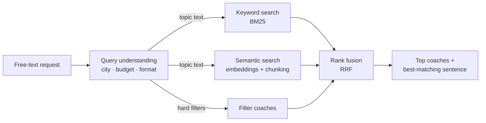

# Coach search: keyword vs. semantic vs. hybrid, measured

**A prototype for matching companies with coaches and trainers from a free-text request — and an honest evaluation of which search method works.**

A company types what it needs in its own words, for example *"Konfliktlösung für unser Vertriebsteam in Hamburg, vor Ort, max. 2.000 €"* (conflict resolution for our sales team in Hamburg, on site, max €2,000). The system has to understand the hard requirements, find the right coaches, and explain why each one fits.

🔎 **Try it:** [live demo](LINK-TO-YOUR-HUGGING-FACE-SPACE) · 📊 **Results:** below · 🧪 **Run it yourself:** `python evaluate.py`

> All 30 coach profiles are **synthetic** — invented names and bios, not real people or platform data.

## How it works



| Step | What it does | Why |
|---|---|---|
| **Query understanding** | Rules extract city, budget and format ("vor Ort" / online) and remove them from the text | Numbers and places must be exact — embeddings don't do maths |
| **Keyword search (BM25)** | Scores word overlap; rare words count more | Exact names: *DISG*, *PRINCE2*, *ChatGPT* |
| **Semantic search** | Multilingual embeddings (`paraphrase-multilingual-MiniLM-L12-v2`), cosine similarity | Synonyms, paraphrases, English queries on German profiles |
| **Chunking** | Scores each profile by its best-matching sentence, not the average of the whole profile | Fixes *dilution*: a profile covering three topics is weak in each when averaged |
| **Hybrid (RRF)** | Merges the keyword and semantic rankings: each coach gets 1 / (60 + rank) from each list | Results both methods agree on rise to the top, with no training |
| **Explanation** | Shows the sentence that matched best | Trust: the company sees *why* a coach was suggested |

## Evaluation

**Golden set:** 15 realistic queries (German and English), each designed to test one weakness — synonyms, exact terms, an English query, German compound words, distractors, filters. Coaches are labelled by hand: **2** = perfect match, **1** = partly right.

**Metrics:** Recall@5 and MRR@10 count perfect matches; nDCG@5 also rewards putting the *best* coach first, using both grades.

**Query understanding** has its own test: 8 example requests, including two traps ("Remote-Teams" is a topic, not a format; "100 Tage" is not a price).

## Results

<!-- Paste the tables from results/results.md here after running `python evaluate.py`. -->

## What I found

<!-- 3–4 bullets in your own words. Prompts:
- Which kinds of queries did keyword search miss completely, and why?
- Did hybrid beat semantic alone? On which queries did it help or hurt?
- Did chunking fix "Gehalt verhandeln" (salary negotiation) without breaking other queries?
- What does the per-query table show that the averages hide?
-->

## Limits

- 30 profiles and 15 queries are far too few for strong claims — a 0.07 difference in MRR is a single query.
- Labels are one person's judgement.
- No real user behaviour (clicks, contact requests, bookings).
- The query parser is rule-based and only knows the cities in this dataset.

## What I'd do next for a real coach marketplace

1. **A real golden set:** 100+ real company requests, labelled by people who know the coaches.
2. **LLM query understanding:** free text → validated JSON (topic, audience, city, budget, format, language), replacing the rules.
3. **A cross-encoder reranker** on the top 50 — kept only if the evaluation shows it helps.
4. **Learning from usage:** contact requests and bookings as signals, with a held-out test set that is never trained on.

## Repository

```
├── app.py            live demo (Gradio)
├── search.py         all search logic: parser, BM25, embeddings, chunking, RRF, explanations
├── evaluate.py       grades every method on the golden set → results/results.md
├── data/
│   ├── coaches.json  30 synthetic profiles (German, with English translations)
│   └── golden.jsonl  15 queries with graded labels
└── requirements.txt
```

The demo and the evaluation share `search.py`, so they always run the same search.

**Run:** `pip install -r requirements.txt gradio` → `python evaluate.py` → `python app.py`

## How it was built

Built with an AI assistant as a pair programmer. I chose the scope, designed the test queries and labels, ran the experiments, and wrote the analysis.

— Viswas Vinayakumar · [GitHub](https://github.com/Viswas-Vinayakumar) · [LinkedIn](https://www.linkedin.com/in/viswasvinayakumar)
